# 错题簿（cuotiben）

考研错题收集 + 间隔复习的 PWA。手机、平板、电脑用浏览器打开同一个网址就能用，数据存在本机。

- 录题三步：拍照 / 相册 / PDF 翻页 → 拖框选出这道题（双指缩放、按住框可拖动）→ 选科目和章节，保存。其余信息（掌握程度、错因标签、来源类型、知识点、难度、来源、错误原因）收在「更多信息」里
- 掌握程度：每道题手动分 4 档（完全不会 / 不熟 / 一般 / 掌握），错题本左侧色条越深越该重点看，可筛选、可一键「重点关注」，不影响 FSRS 排期
- 复习：每天自动列出到期的错题，四档自评后 FSRS-5 计算下次时间；答案图默认隐藏，点开后可放大
- 每科题量：在「我的 → 学习目标」给每科定每天几道；到期的题不够就自动从该科「最快要到期」的题里补齐，超出部分留到明天
- 手写：默认关闭，点「开启手写」才接管触摸（之前可以正常上下滑动）；平板上可直接在题干批注，复习时另起一层作答
- 套卷：按分类挑题组一张有顺序的卷子，或按遗忘曲线抽「最可能忘」的题；839 按历年真题卷型固定 8 道大题（一题一章），数学二 22 题
- 统计：16 周热力图、未来 14 天到期预测常开，正确率 / 错因分布 / 章节掌握度折叠成一行摘要，点开才展开
- 首页：今日队列 + 每科进度条 + 今日目标进度环 + 接下来 1/3/7 天；「今日已复习 / 近 7 天 / 未掌握」三张卡点开可逐题细看
- 改期：3 / 7 / 14 / 30 天，或自定义任意天数
- 分类：科目 → 章节 → 知识点标签；「真题」单独成一支，可按年份筛选
- 备份：一键导出**加密**备份（AES-256-GCM），换设备时导入恢复；带存储持久化状态与数据完整性自检

## 截图

| 今日（每科题量 + 组卷入口） | 近 7 天细看 | 组一套卷 |
| --- | --- | --- |
| 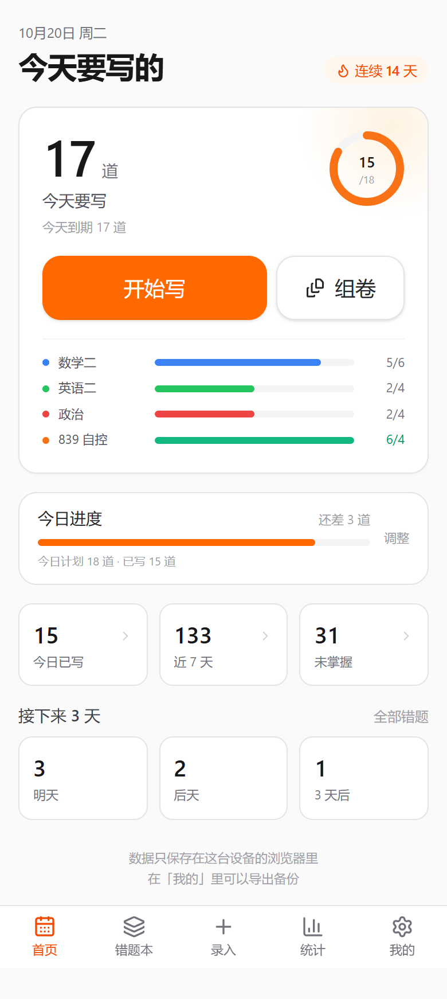 | 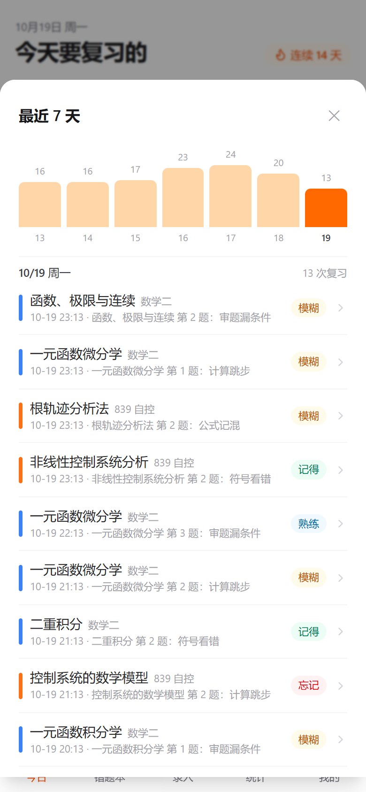 | 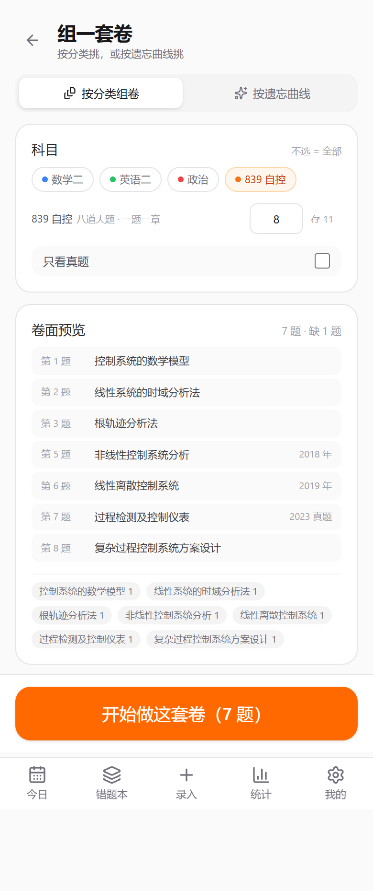 |

| 套卷作答 | 统计（折叠） | 统计（展开） |
| --- | --- | --- |
| 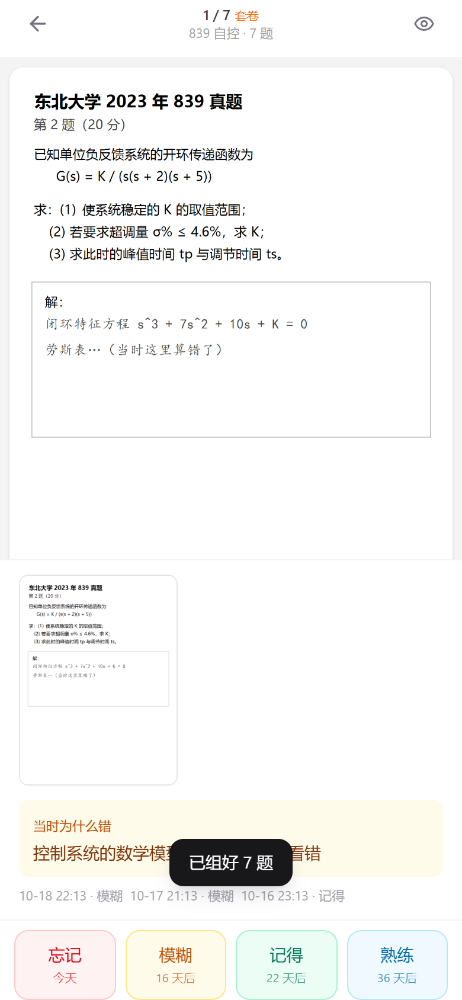 | 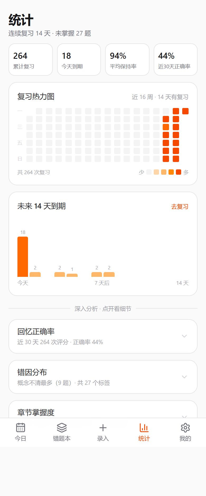 | 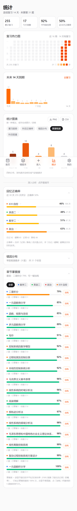 |

| 每科题量 | 复习手写 | 批注 |
| --- | --- | --- |
| 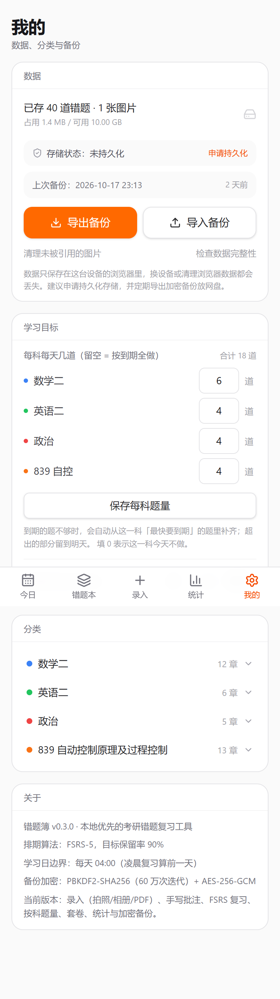 | 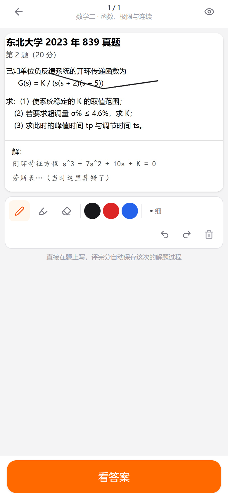 | 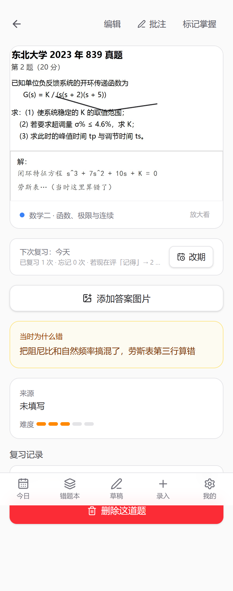 |

| 错题本（色条 = 掌握程度） | 掌握程度筛选 | 题目页改级 |
| --- | --- | --- |
|  | 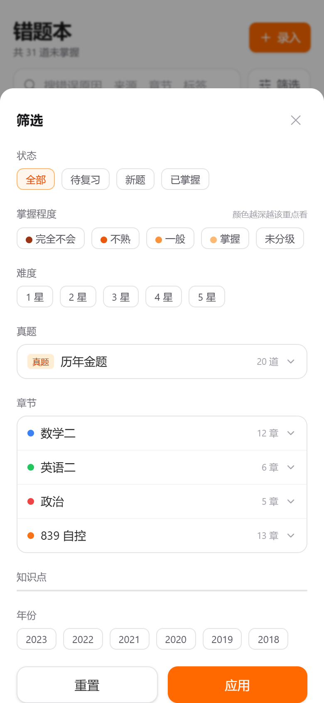 | 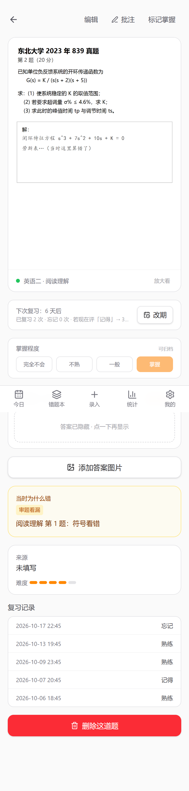 |

## 部署到 GitHub Pages（推荐）

**当前线上地址：https://iroqiuli.github.io/mistake-notebook/**
（仓库：[IroQiuli/mistake-notebook](https://github.com/IroQiuli/mistake-notebook)）

部署后是 HTTPS，可以像 App 一样安装，并且能用 Service Worker 离线打开。

```bash
git remote add origin git@github.com:<用户名>/<仓库名>.git
git push -u origin main
```

首次部署只要在仓库里点一次 **Settings → Pages → Source 选「GitHub Actions」**。
这一步没法由工作流代劳：GITHUB_TOKEN 没有创建 Pages 站点的管理员权限
（会报 `Resource not accessible by integration`），所以脚本里不做自动开启。

之后每次推 `main`，`.github/workflows/deploy.yml` 会自动跑
`npm ci → npm test → npm run build → deploy-pages`，并注入
`VITE_BASE=/<仓库名>/`，保证静态资源挂在子路径下能正确加载。

- 手机：Chrome 菜单 →「安装应用 / 添加到主屏幕」；iPhone 必须用 Safari →「共享」→「添加到主屏幕」
- 仓库要设为 **public**（免费账号的 Pages 只对公开仓库开放）

其他平台同理，构建产物是纯静态文件、路由用 Hash 模式：

| 平台 | 构建命令 | 输出目录 |
| --- | --- | --- |
| Cloudflare Pages / Netlify | `npm run build` | `dist` |

> 换域名等于换数据库：浏览器的 IndexedDB 绑定在域名上。迁移只能用「导出加密备份 → 新域名导入」。
> 从局域网 `http://192.168.x.x` 迁到 `https://…github.io` 也要走这一步。

## 本地开发

```bash
npm install
npm run dev          # http://localhost:5173
npm test             # 单测（Vitest）
npm run build        # 产出 dist/
npm run preview      # 预览构建结果
```

冒烟测试（用本机 Edge，不需要下载 Chromium）：

```bash
npm run preview -- --port 5199
node scripts/e2e-smoke.mjs    # 录题→复习→手写→批注→统计
node scripts/e2e-stats.mjs    # 灌演示数据并截统计页
node scripts/e2e-pdf.mjs      # 用 ../考研资料/自控 里的真题 PDF 跑一遍截题
node scripts/e2e-backup.mjs   # 加密导出 → 全新浏览器配置导入还原
node scripts/e2e-paper.mjs    # 每科题量 + 首页细看 + 套卷组卷作答
node scripts/e2e-mastery.mjs  # 掌握程度分级 → 色条/徽标 → 筛选 → 详情改级
node scripts/shots-demo.mjs   # 生成 README 用的演示截图（docs/screenshots）
```

## 数据是怎么保存的

**存储结构**：浏览器 IndexedDB（库名 `cuotiben`，Dexie 管理），10 张表：

| 表 | 内容 |
| --- | --- |
| `subjects` / `chapters` / `topics` | 分类树（科目 → 章节 → 知识点） |
| `problems` | 错题：题干图 id、答案图 id、错因标签、来源、难度、备注 |
| `cards` | FSRS 卡片：稳定度、难度、到期时间、复习次数 |
| `reviewLogs` | 每次评分记录（用于热力图、正确率、留存率） |
| `assets` | 图片二进制，以 `ArrayBuffer` 存（不是 Blob，避免结构化克隆问题） |
| `inks` | 手写笔迹，坐标按图片宽度归一化，换设备分辨率也能对齐 |
| `settings` | 每日目标、上次备份时间等 |

**安全保存方案**（按风险逐条对应）：

| 风险 | 应对 | 实现 |
| --- | --- | --- |
| 浏览器自动清理站点数据 | 申请持久化存储；「我的」显示已/未持久化，可手动再申请 | `navigator.storage.persist()` / `persisted()` |
| 手机丢失、换设备 | 导出加密备份，新设备导入还原 | `exportBackup()` + `importBackup()` |
| 备份文件被网盘/他人看到 | 口令加密：PBKDF2-SHA256 60 万次迭代派生密钥，AES-256-GCM 加密，头部作为 AAD 参与认证 | `src/storage/crypto.ts` |
| 备份被篡改 | GCM 认证标签，改动任意一位都会解密失败并提示「密码不对或文件已损坏」 | 同上 |
| 忘记密码 | 无后门、无托管：明确提示「忘记密码 = 无法恢复」，建议记进密码管理器 | 导出弹窗 |
| 导入不完整 / 数据被劫持一半 | 自检：统计缺题干图、缺答案图、无引用图片、孤立卡片，可一键清理 | `src/storage/integrity.ts` |
| 误删、误导入 | 导入按 id 合并，同 id 以备份为准，不删除本机其它题目 | `importBackup()` |
| 忘记备份 | 首页超过 7 天显示提醒 | 今日页横幅 |

**备份包格式**

```
cuotiben-backup-20261019.ctbx        # 加密包
  CTBX | 版本(1) | salt(16) | iv(12) | AES-256-GCM 密文
        └─ 解密后是 zip ─────────────┐
cuotiben-backup-20261019.zip         # 不加密（仅临时搬运）
  manifest.json   格式版本、导出时间、各类数量
  data.json       除图片外的全部表
  assets/*.bin    图片原始字节
```

密码不写入文件、不上传服务器、不存 localStorage：只在内存里参与密钥派生。

**没做云同步**，这是刻意的：多端同时改同一道题时，自动同步需要冲突合并策略和服务端，
而"导出 → 导入（同 id 覆盖）"在单人使用时语义更可预期。代价是换设备要手动搬一次备份。

## 套卷与每科题量

**每科题量**：`我的 → 学习目标`，每科填一个数（留空 = 按到期全做，0 = 这科今天不做）。
今日队列按「到期优先 → 不够就补该科最快要到期的题」组成，超出的部分留到明天。
首页会显示每科的 `已做 / 目标` 进度条。

**套卷**（`今日 → 组卷`）两种挑法：

| 模式 | 规则 |
| --- | --- |
| 按分类 | 选科目（可多选）、题量、只看真题；按章节轮转抽题，保证一张卷覆盖尽量多的章节 |
| 按遗忘曲线 | 按 FSRS 的「现在还记得的概率」从低到高抽，先练最可能忘的 |

题量默认值来自历年真题卷型（`src/domain/paper.ts` 的 `PAPER_PRESETS`）：

| 科目 | 默认 | 依据 |
| --- | --- | --- |
| 数学二 | 22 题 | 10 选择 + 6 填空 + 6 解答 |
| 839 自控 | 8 道大题 | 第 1~6 题自控（建模/时域/根轨迹/频域校正/非线性/离散），第 7~8 题过控（检测仪表与机理建模 / 复杂控制方案设计），一题一章 |
| 英语二 | 48 题 | 先给默认值，可手动改 |
| 政治 | 38 题 | 先给默认值，可手动改 |

生成的卷子存成 `settings.activePaper`（只存题目顺序），复习时按顺序走同一套
「看答案 → 四档评分」流程，评分照常写进 FSRS。做完自动清除，可一键「再组一套」。

## 掌握程度

每道题可以手动标 4 档，同一色相由深到浅 —— **颜色越深 = 越不熟 = 越该重点看**：

| 档位 | 颜色 | 提示 |
| --- | --- | --- |
| 完全不会 | `#9a3412` 深赭 | 重点看 |
| 不熟 | `#ea580c` | 多练 |
| 一般 | `#fb923c` | 保持 |
| 掌握 | `#fdba74` 最浅 | 可归档 |

- 错题本每行左侧 3px 色条就是这把刻度；1~2 档会在列表上带「重点·」前缀
- 筛选面板「掌握程度」可多选，也能单独筛「未分级」；错题本顶部「重点关注」是一键开关（= 1~2 档）
- 录入时收在「更多信息 → 掌握程度」，详情页随时改，再点一次取消分级
- 这是**主观标记**，不参与 FSRS 排期；和「标记掌握（归档）」是两件事：
  归档 = 不再排期，掌握程度 = 你现在心里对这道题的把握

## 结构

```
src/
  domain/     纯逻辑：类型、学习日、FSRS 排期、复习队列、套卷挑选、检索筛选
  storage/    Dexie schema、种子数据、图片、CRUD、加密备份、完整性自检、进行中的套卷
  features/   today / capture / library / problem / review / stats / paper / settings
  ui/         Button、Dialog、Collapsible、Toast、EmptyState、ZoomableImage
  hooks/      useAssetUrl
.github/workflows/deploy.yml   GitHub Pages 构建与发布
```

约定：`domain/` 不依赖 React 和存储层；`storage/` 不做业务判断；页面只做编排。

## 里程碑

- [x] **M1 能录能复习**：录入（拍照/相册 + 框选 + 增强）、错题本、详情、FSRS 复习、备份
- [x] **M2 能手写**：题干批注、复习作答层、钢笔/荧光笔/橡皮/撤销重做
- [x] **M3 能导卷子**：PDF 翻页渲染 + 高分辨率截题（Word 导入待做）
- [x] **M4 有反馈**：复习热力图、14 天到期预测、章节掌握度、错因分布、每日目标
- [x] **M5 可安装**：GitHub Pages 部署、加密备份、存储持久化、完整性自检
- [x] **M6 能组卷**：每科每日题量、首页卡片逐题细看、统计折叠、按分类/遗忘曲线组套卷
- [x] **M7 能分级**：每道题手动标掌握程度（四档色阶），错题本色条 + 「重点关注」快捷筛选

设计文档见 `docs/superpowers/specs/2026-10-19-cuotiben-design.md`，
实施计划见 `docs/superpowers/plans/2026-10-19-m1-capture-review.md`。

## 已知限制

1. 无 OCR：搜索只覆盖文字字段（错误原因、来源、章节、标签）。
2. Word（.docx）导入还没做，需要的话先另存为 PDF 再导入。
3. iOS PWA 的存储仍可能被系统回收，加密备份是必需操作。
4. 通知提醒在 iOS PWA 上不可靠，以首页角标为主。
5. 换浏览器 / 换域名 = 换数据库，迁移只能靠备份包。
6. 手写层按图片宽度铺满显示，暂不支持在批注模式下双指缩放（可用「放大看」看原图）。
7. 备份是"手动 + 提醒"，没有自动定时备份：浏览器不允许网页在没打开时写文件。
