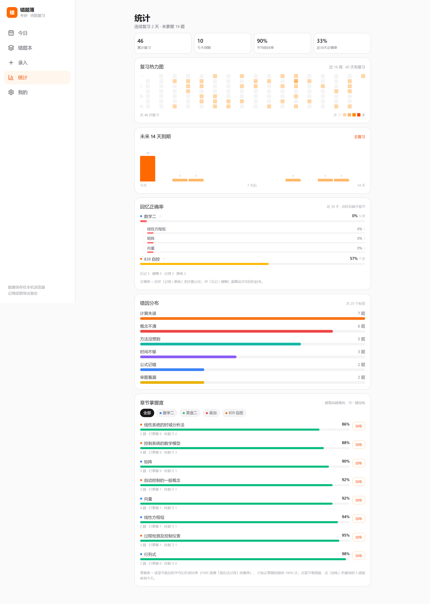
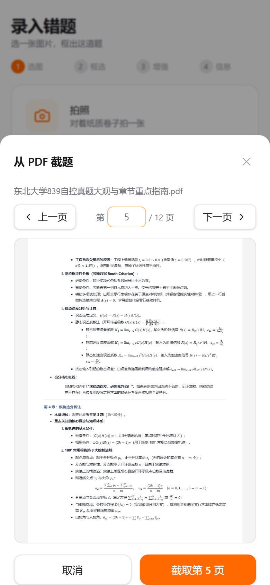
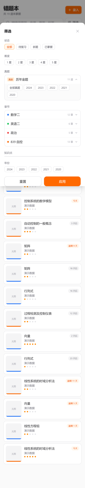
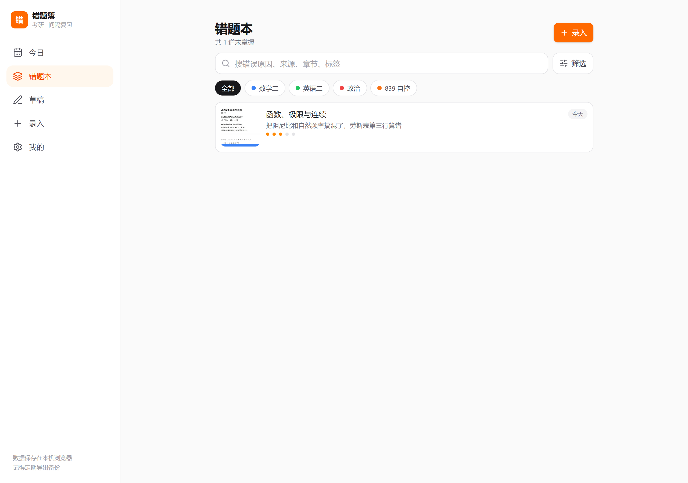

# 错题簿（cuotiben）

考研错题收集 + 间隔复习的 PWA。手机、平板、电脑用浏览器打开同一个网址就能用，数据存在本机。

- 录题三步：拍照 / 相册 / PDF 翻页 → 拖框选出这道题（双指缩放、按住框可拖动）→ 选科目和章节，保存。其余信息（错因标签、来源类型、知识点、难度、来源、错误原因）收在「更多信息」里
- 复习：每天自动列出到期的错题，四档自评后 FSRS-5 计算下次时间；答案图默认隐藏，点开后可放大
- 手写：默认关闭，点「开启手写」才接管触摸（之前可以正常上下滑动）；平板上可直接在题干批注，复习时另起一层作答
- 统计：16 周热力图、未来 14 天到期预测、按科目/章节的正确率、错因分布、章节掌握度与一键加练
- 首页：今日队列 + 今日目标进度环 + 接下来 1/3/7 天各有多少题到期
- 改期：3 / 7 / 14 / 30 天，或自定义任意天数
- 分类：科目 → 章节 → 知识点标签；「真题」单独成一支，可按年份筛选
- 备份：一键导出 zip（含图片），换设备时导入恢复

## 截图

| 今日 | 复习手写 | 批注 |
| --- | --- | --- |
|  |  |  |

| 统计 | 正确率（按科目展开） | PDF 截题 |
| --- | --- | --- |
|  |  |  |

| 错题本 | 真题筛选 | 桌面宽屏 |
| --- | --- | --- |
|  |  |  |

## 本地开发

```bash
npm install
npm run dev          # http://localhost:5173
npm test             # 领域逻辑单测（Vitest）
npm run build        # 产出 dist/
npm run preview      # 预览构建结果
```

冒烟测试（用本机 Edge，不需要下载 Chromium）：

```bash
npm run dev -- --port 5199
node scripts/e2e-smoke.mjs   # 录题→复习→手写→批注→草稿，截图输出到 .cache/shots/
node scripts/e2e-pdf.mjs     # 用 ../考研资料/自控 里的真题 PDF 跑一遍截题
```

## 部署

构建产物是纯静态文件，`base` 已设为相对路径、路由用 Hash 模式，可以放在任意子目录。

**GitHub Pages**

1. 新建仓库并推送本目录。
2. Settings → Pages → Source 选 `GitHub Actions`。
3. 推送到 `main` 后，`.github/workflows/deploy.yml` 会自动构建并发布。
4. 用 `https://<用户名>.github.io/<仓库名>/` 打开，手机上「添加到主屏幕」。

**Cloudflare Pages**

- 构建命令：`npm run build`
- 输出目录：`dist`
- 框架预设：无（或 Vite）

> 换域名等于换数据库：浏览器的 IndexedDB 绑定在域名上。迁移只能用「导出备份 → 新域名导入」。

## 数据说明

- 所有数据（题目、图片、笔迹、复习记录）只存在浏览器的 IndexedDB 里，不上传任何服务器。
- 启动时会请求 `navigator.storage.persist()`，降低被浏览器自动清理的概率；iOS 上仍可能回收长期不用的站点数据。
- 首页超过 7 天没备份会出现提醒。备份文件建议放网盘。
- 图片按长边 2400px、JPEG 0.9 存储，1000 道题大约 300–500 MB。

## 结构

```
src/
  domain/     纯逻辑：类型、学习日、FSRS 排期、复习队列、检索筛选
  storage/    Dexie schema、种子数据、图片 Blob、错题 CRUD、备份导入导出
  features/   today / capture / library / problem / review / settings
  ui/         Button、Dialog、Toast、EmptyState、ZoomableImage
  hooks/      useAssetUrl
```

约定：`domain/` 不依赖 React 和存储层；`storage/` 不做业务判断；页面只做编排。

## 里程碑

- [x] **M1 能录能复习**：录入（拍照/相册 + 框选 + 增强）、错题本、详情、FSRS 复习、备份
- [x] **M2 能手写**：题干批注、复习作答层、钢笔/荧光笔/橡皮/撤销重做
- [x] **M3 能导卷子**：PDF 翻页渲染 + 高分辨率截题（Word 导入待做）
- [x] **M4 有反馈**：复习热力图、14 天到期预测、章节掌握度（深色模式与安装引导待做）

设计文档见 `docs/superpowers/specs/2026-10-19-cuotiben-design.md`，
实施计划见 `docs/superpowers/plans/2026-10-19-m1-capture-review.md`。

## 已知限制

1. 无 OCR：搜索只覆盖文字字段（错误原因、来源、章节、标签）。
2. Word（.docx）导入还没做，需要的话先另存为 PDF 再导入。
3. iOS PWA 的存储可能被系统回收，备份是必需操作。
4. 通知提醒在 iOS PWA 上不可靠，以首页角标为主。
5. 换浏览器 / 换域名 = 换数据库，迁移只能靠备份包。
6. 手写层按图片宽度铺满显示，暂不支持在批注模式下双指缩放（可用「放大看」看原图）。
7. 用局域网 `http://192.168.x.x` 访问时不是安全上下文，浏览器不提供 `crypto.randomUUID`、Service Worker、存储持久化——代码里已做 UUID 降级，但**离线缓存与安装只能靠 HTTPS 部署**。
